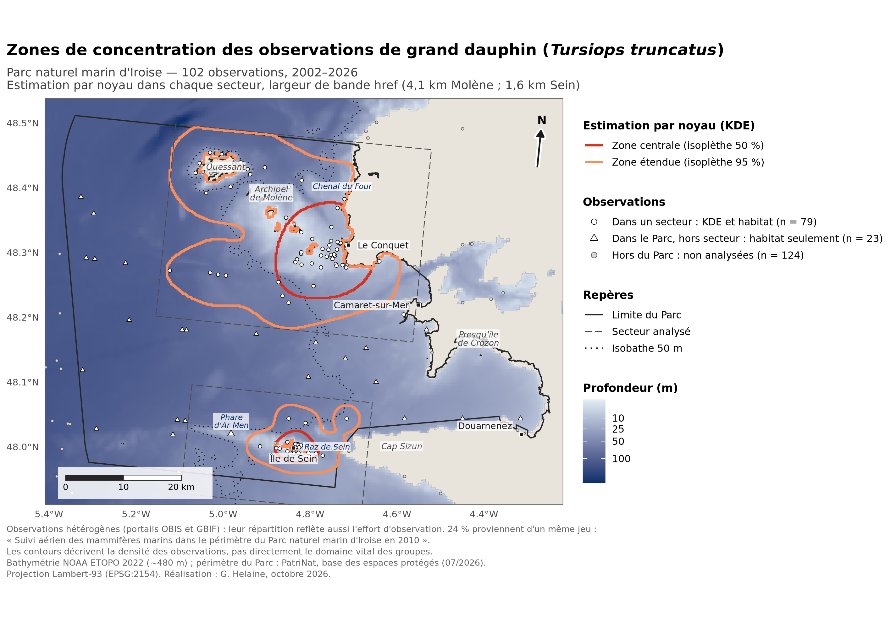

# Grands dauphins d'Iroise et trafic maritime : analyse exploratoire

Exercice préparatoire réalisé dans le cadre de ma candidature au poste de **chargé(e) de mission projet Delfinu – Iroise** (OFB, Parc naturel marin d'Iroise), à partir de données publiques uniquement.

**À lire en premier : [note.pdf](note.pdf).** La page 1 en donne la synthèse ; les pages suivantes détaillent méthodes, résultats et limites.

  

<em>Zones de concentration des observations (estimation par noyau) dans les secteurs de Molène et de Sein.</em>

## Démarche

- Nettoyage et contrôle qualité des observations publiques (OBIS, GBIF) de grand dauphin (*Tursiops truncatus*), avec détection de deux défauts : positions ramenées sur une grille et doublons imprécis.
- Estimation par noyau des zones de concentration des observations (Molène, Sein) et tests de sensibilité.
- Comparaison avec les suivis par photo-identification publiés.
- Croisement descriptif avec le trafic maritime (AIS, EMODnet 2023, hors pêche professionnelle), avec contrôle de la proximité de la côte.
- À titre de démonstration, versement des données dans une base PostgreSQL / PostGIS consultable dans QGIS.

## Principaux résultats

- 918 enregistrements publics, **102 observations retenues** dans le Parc après nettoyage.
- Deux zones de concentration, Molène – Le Conquet et Sein, cohérentes avec les groupes connus ; leur localisation est stable, leur surface ne l'est pas.
- La plaisance, la voile et les navires à passagers traversent ces zones ; à distance de la côte comparable, seuls les navires à passagers y sont plus présents.
- Ces données ne permettent ni de délimiter un domaine vital ni de mesurer des interactions.

## Contenu du dépôt

| Fichier | Rôle |
|---|---|
| `note.pdf`, `note.qmd` | Note (version PDF et source Quarto) |
| `analyse.R` | Script principal : téléchargement, contrôle qualité, zones, habitat, trafic, figures |
| `postgis.R`, `requetes.sql`, `lieux.sql` | Base PostgreSQL / PostGIS et requêtes SQL ; résultats dans `journal_requetes.txt` et `01_…csv` à `07_…csv` |
| `fond_carte_qgis.py`, `etiquettes_lieux_qgis.py` | Scripts QGIS (fond de carte, étiquettes) |
| `*.png` | Cartes et graphiques de la note |
| `observations_propres_parc.csv`, `journal_nettoyage.csv`, `dictionnaire_donnees.csv` | Observations nettoyées, étapes du nettoyage, description des colonnes |
| autres `*.csv` | Résultats chiffrés (zones, sensibilité, habitat, trafic, enregistrements exclus) |
| `GUIDE_IROISE.md`, `delfinu-iroise.Rproj` | Guide d'installation et projet RStudio |

Pour reproduire l'analyse : ouvrir le projet RStudio, déposer le périmètre du Parc (PatriNat) et les rasters EMODnet dans `data/raw/`, puis lancer `analyse.R` (détails dans `GUIDE_IROISE.md`).

## Outils

R (`sf`, `terra`, `dplyr`, `ggplot2`), PostgreSQL / PostGIS, QGIS, Quarto.

## Sources et licences

Observations : OBIS, GBIF (dont suivi aérien du Parc en 2010, Observatoire Pelagis, iNaturalist, Observation.org) ; bathymétrie : NOAA ETOPO 2022 ; trafic : EMODnet Human Activities, densité de navires 2023 ; périmètre : PatriNat, base des espaces protégés ; fond de carte QGIS : © Esri.

Le code est librement réutilisable. Les observations restent soumises à la licence de leur jeu de données d'origine, indiquée sur OBIS et GBIF ; toute réutilisation doit citer ces jeux.

---
*Le code et la note ont été réalisés avec l'aide d'un assistant d'IA (Claude, Anthropic). J'ai conduit la démarche, vérifié les données, les résultats et les références, et arbitré les choix de méthode et d'interprétation.*
