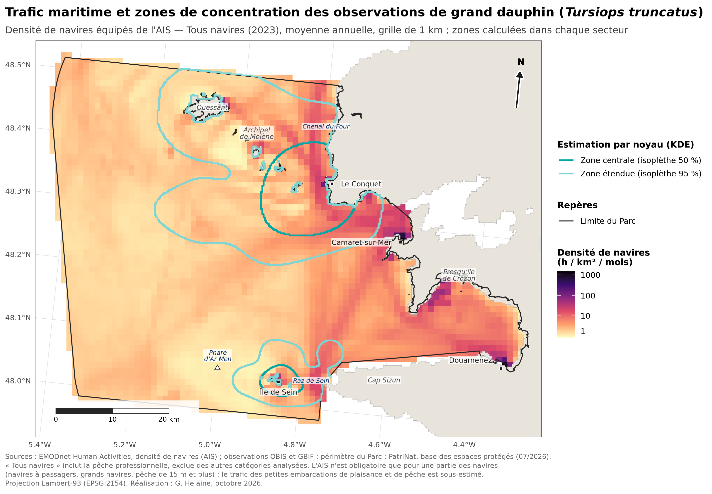
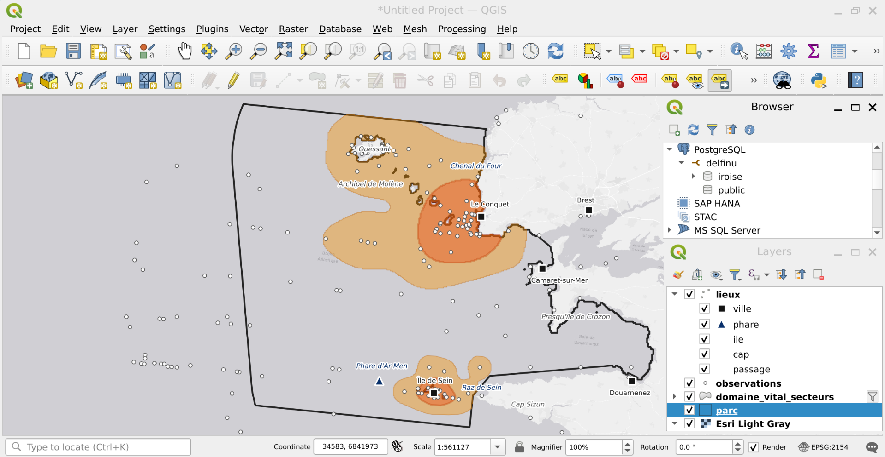

# Grands dauphins du Parc naturel marin d'Iroise : zones de concentration des observations et trafic maritime

Analyse exploratoire, à partir de données ouvertes, de la répartition des observations de grand dauphin (*Tursiops truncatus*) dans le Parc naturel marin d'Iroise, comparée aux suivis par photo-identification publiés et croisée avec le trafic maritime (hors pêche professionnelle). Les données et les résultats sont bancarisés dans une base PostgreSQL/PostGIS. Exercice préparatoire au projet Delfinu.

**Auteure :** Gwladys Helaine — octobre 2026

**À lire en premier :** [`note.pdf`](note.pdf), la note de synthèse (méthodes, résultats, limites, conclusion).

  
  

<em>À gauche : zones de concentration des observations, estimées dans les secteurs de Molène et de Sein. À droite : densité de navires (AIS, 2023).</em>

## Principaux résultats

- **Contrôle qualité** : 918 enregistrements bruts (OBIS, GBIF) → 226 observations conservées dans l'emprise d'étude, dont **102 dans le Parc**. Deux défauts des données publiques ont été détectés et filtrés automatiquement : des positions ramenées au centre d'un quadrillage régulier (82 enregistrements, jusqu'à 24 observations empilées sur un même point) et des doublons moins précis d'observations publiées dans d'autres jeux (28 enregistrements).
- **Localisation** : les observations se concentrent en deux zones, entre l'est de l'archipel de Molène et Le Conquet, et autour de l'île de Sein, en accord général avec les deux groupes côtiers décrits par les suivis par photo-identification. Cette localisation est stable lorsque l'on modifie le découpage des secteurs ou la largeur de bande.
- **Surfaces** : très sensibles aux choix d'analyse (de 105 à 274 km² pour la zone centrale de Molène, de 14 à 93 km² pour celle de Sein) ; ce ne sont pas des estimations fiables du domaine vital.
- **Effort d'observation** : à Sein, les observations publiques se situent près du port et presque jamais vers le phare d'Ar Men, à l'ouest de la chaussée, secteur où le suivi du Parc a rencontré en 2021 un groupe sans doute de passage et qu'il recommandait de prospecter plus régulièrement : la répartition des données publiques reflète aussi celle de l'effort d'observation.
- **Trafic** : la densité médiane de navires équipés de l'AIS est plus élevée dans les zones de concentration que dans l'ensemble du Parc, mais cet écart tient à la proximité de la côte. Comparées aux autres eaux côtières, à distance de la côte équivalente, les zones de concentration sont moins fréquentées par la plaisance et la voile ; seuls les navires à passagers, notamment sur les liaisons vers les îles, y sont plus présents.
- **Portée** : ces données permettent de cartographier les observations disponibles, pas de délimiter le domaine vital des groupes, de démontrer une sélection de l'habitat ou de quantifier une exposition au trafic.

## Nettoyage des observations

Les observations sont téléchargées depuis OBIS (149 enregistrements) et le GBIF (769). La requête au GBIF ne retient déjà que les enregistrements géolocalisés et sans problème géographique signalé par le portail. Les deux tableaux sont réduits à dix colonnes communes (position, date, précision, type d'enregistrement, jeu de données, effectif, statut), puis filtrés dans l'ordre ci-dessous ; chaque étape est enregistrée dans `journal_nettoyage.csv`.

| Étape | Règle appliquée | Retirés | Restant | Raison |
|---|---|---|---|---|
| Données de départ | — | — | 918 | |
| Coordonnées | Longitude et latitude présentes et dans les bornes possibles | 0 | 918 | Position indispensable |
| Absences | Statut « absent » exclu | 0 | 918 | Une absence ne localise pas l'espèce |
| Spécimens | Types *preserved specimen* et *fossil specimen* exclus | 1 | 917 | Pièce de collection, pas une observation en mer |
| Échouages | Jeux dont le nom contient « échouage » ou « stranding » exclus | 173 | 744 | Animaux morts sur la côte |
| Doublons exacts | Une seule ligne par position (arrondie à environ 100 m) et par date | 109 | 635 | OBIS republie une partie des données du GBIF |
| Dates | Date connue et année ≥ 2000 | 23 | 612 | Données trop anciennes ou non datées |
| Précision | Incertitude déclarée ≤ 5 km ; les enregistrements sans incertitude déclarée sont conservés | 236 | 376 | Position trop imprécise à l'échelle des zones étudiées |
| Positions sur grille | Longitude et latitude toutes deux multiples exacts de 5′ exclues | 82 | 294 | Positions ramenées au centre d'une maille (jusqu'à 24 observations sur un même point), précision déclarée erronée ; détail dans `exclus_positions_grille.csv` |
| Points à terre | Points dont l'altitude lue sur la bathymétrie atteint 20 m ou plus exclus (tolérance liée à la maille d'environ 500 m) | 35 | 259 | Erreur de position |
| Doublons imprécis | Donnée d'incertitude ≥ 5 km exclue si un autre jeu donne, le même jour et à moins de 10 km, une position plus précise | 28 | 231 | Probablement la même observation, republiée avec une localisation moins précise ; détail dans `exclus_doublons_floutes.csv` |
| Agrégation | Une observation par carré de 1 km et par jour | 5 | 226 | Limiter la pseudo-réplication (même groupe noté plusieurs fois) |
| Parc | Observations situées dans la partie marine du Parc | 124 | 102 | Les observations hors du Parc sont conservées comme contexte sur les cartes |

Les deux contrôles sur les positions sur grille et les doublons imprécis ont été ajoutés après examen des données. Les seuils (année, précision, tolérance, taille des carrés) sont regroupés en tête de `analyse.R`.

## Base de données PostgreSQL / PostGIS

  

<em>Projet QGIS lisant directement les tables du schéma <code>iroise</code> de la base PostGIS.</em>

Le schéma `iroise` contient les observations nettoyées, le périmètre du Parc, les zones estimées et des repères géographiques, avec index spatiaux, contrainte de cohérence et commentaires. Les requêtes de `requetes.sql` (jointure spatiale avec le Parc, recherche dans un rayon autour de Sein, surfaces, distance entre zones, contrôle des doublons) et leurs résultats sont consignés dans `journal_requetes.txt`.

## Contenu du dépôt

| Fichier | Rôle |
|---|---|
| `analyse.R` | Script complet : téléchargement, contrôle qualité, zones de concentration, habitat, trafic, figures, exports |
| `postgis.R` | Bancarisation dans PostgreSQL/PostGIS et exécution des requêtes |
| `requetes.sql` | Requêtes SQL spatiales d'exemple |
| `lieux.sql` | Création de la table des repères géographiques |
| `fond_carte_qgis.py`, `etiquettes_lieux_qgis.py` | Scripts Python pour QGIS (fond de carte, repères et étiquettes) |
| `note.qmd` / `note.pdf` | Note de synthèse (source Quarto et version PDF) |
| `carte_domaine_vital.png`, `carte_secteur_molene.png`, `carte_secteur_sein.png`, `carte_trafic.png`, `carte_trafic_categories.png` | Cartes (trafic : tous navires, puis par catégorie) |
| `schema_synthese.png` | Schéma simplifié de la page de synthèse de la note |
| `habitat_profondeur_cote.png`, `trafic_par_zone.png`, `sensibilite_secteur_molene.png`, `sensibilite_secteur_sein.png` | Graphiques |
| `observations_propres_parc.csv`, `journal_nettoyage.csv`, `dictionnaire_donnees.csv` | Observations nettoyées, étapes du nettoyage, description des colonnes |
| `exclus_positions_grille.csv`, `exclus_doublons_floutes.csv` | Détail des enregistrements exclus par les deux contrôles qualité spécifiques |
| `domaine_vital_secteurs.csv`, `sensibilite_secteurs.csv`, `observations_secteurs.csv` | Surfaces, sensibilité au découpage, effectifs par secteur |
| `surfaces_domaine_vital.csv`, `sensibilite_domaine_vital.csv` | Première estimation sur l'ensemble du Parc, avant le découpage en secteurs, et sa sensibilité à la largeur de bande |
| `habitat_resume.csv`, `modele_habitat.csv`, `trafic_par_zone.csv`, `trafic_secteurs.csv`, `trafic_controle_cote.csv` | Résultats chiffrés |
| `journal_requetes.txt`, `01_…csv` à `07_…csv` | Requêtes SQL exécutées et leurs résultats (journal et un fichier par requête) |
| `delfinu-iroise.Rproj`, `GUIDE_IROISE.md` | Projet RStudio et guide d'installation |

## Reproduire l'analyse

1. Ouvrir `delfinu-iroise.Rproj` dans RStudio.
2. Déposer le périmètre du Parc (`sig_metrop.gpkg`, base des espaces protégés de PatriNat) dans `data/raw/parc/` et les rasters de densité de navires EMODnet (moyenne annuelle 2023 : tous navires, plaisance, voile, passagers) dans `data/raw/trafic/`.
3. Lancer `analyse.R` : le script télécharge les observations et la bathymétrie, puis recrée tous les résultats (`data/propre/`, `outputs/`).
4. Pour la base : installer PostgreSQL et PostGIS, créer la base `delfinu` (voir `GUIDE_IROISE.md`), puis lancer `postgis.R` et `lieux.sql`.
5. Rendre `note.qmd` avec Quarto.

Les données téléchargées sont conservées dans `data/raw/` : un nouveau lancement réutilise exactement les mêmes données. Les versions de R et des packages et la date de chaque source sont enregistrées dans `outputs/`.

## Sources de données

- Observations : OBIS, GBIF (dont suivi aérien du Parc en 2010, Observatoire Pelagis, iNaturalist, Observation.org)
- Bathymétrie : NOAA ETOPO 2022
- Trafic maritime : EMODnet Human Activities, densité de navires (AIS), moyenne annuelle 2023
- Périmètre : PatriNat, base des espaces protégés (07/2026)
- Fond de carte QGIS : © Esri

## Méthodes et outils

Contrôle qualité automatisé ; estimation par noyau (isoplèthes 50 % et 95 %) dans deux secteurs, avec tests de sensibilité au découpage et à la largeur de bande ; comparaison avec les suivis par photo-identification publiés ; comparaison utilisation / disponibilité de l'habitat (tests de Wilcoxon, régression logistique) ; comparaison descriptive de la densité de navires entre zones, avec contrôle de la proximité de la côte. Outils : R (sf, terra, dplyr, ggplot2), PostgreSQL/PostGIS, QGIS, Quarto.

Une première version de cette démarche a été appliquée au Parc naturel marin du Cap Corse et de l'Agriate : [delfinu-domaine-vital](https://github.com/gwladys-helaine/delfinu-domaine-vital).

## Licence et utilisation des données

Le code est librement réutilisable. Les observations restent soumises à la licence de leur jeu de données d'origine, indiquée sur OBIS et GBIF ; toute réutilisation doit citer ces jeux.

*Le code et la note ont été réalisés avec l'aide d'un assistant d'IA (Claude, Anthropic). J'ai conduit la démarche, vérifié les données, les résultats et les références, et arbitré les choix de méthode et d'interprétation.*
